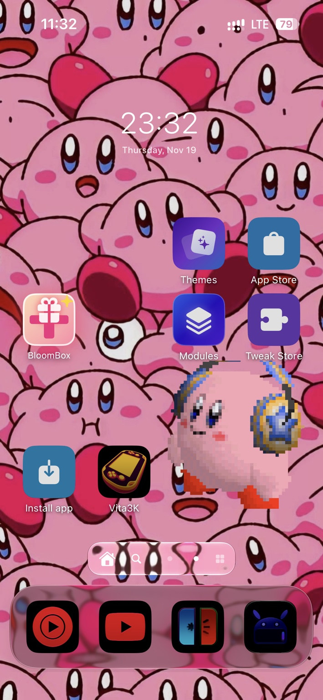
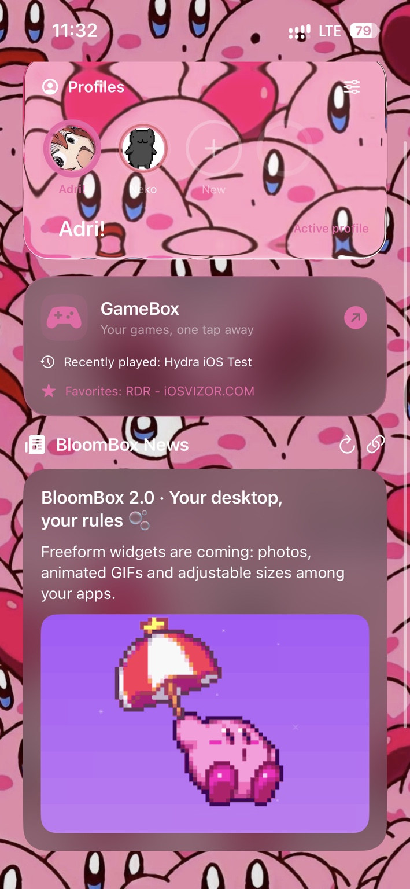
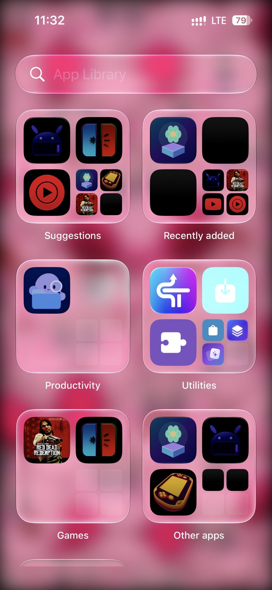
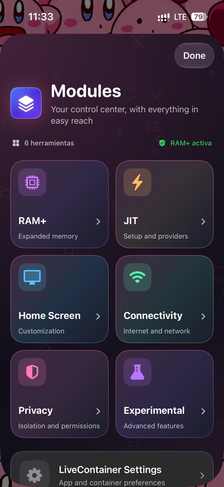
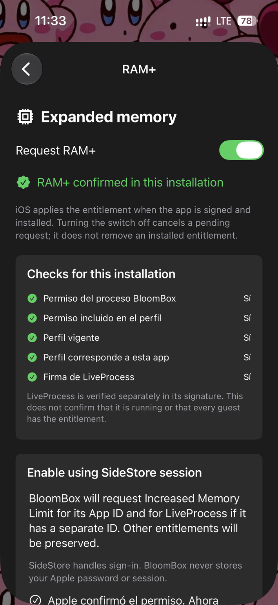
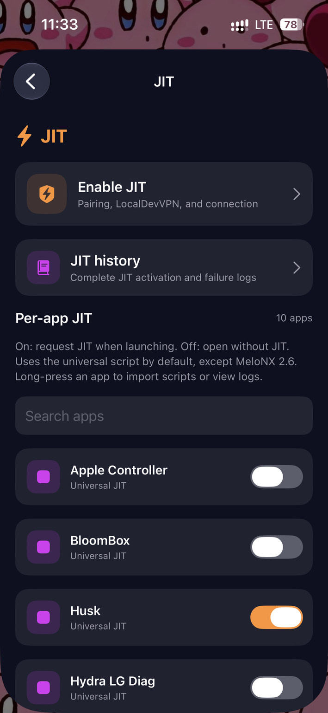
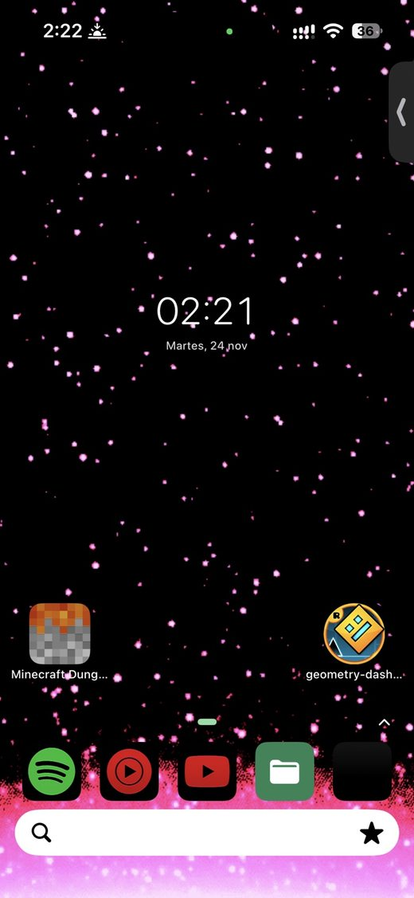
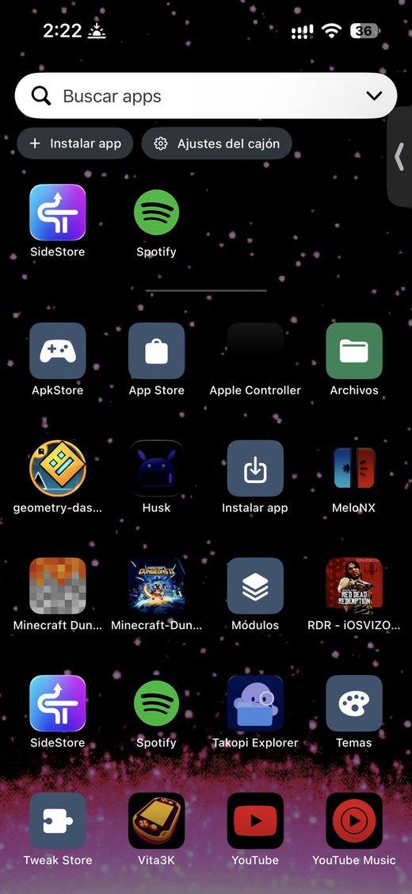

# BloomBox

### Less configuring. More enjoying your iPhone.

A personal home for your apps, widgets and files — with room to experiment.

[**Download BloomBox 3.6.0**](https://github.com/AdriFOG/Bloombox-iOS/releases/latest) · [Builds](https://github.com/AdriFOG/Bloombox-iOS/actions/workflows/build.yml) · [Report an issue](https://github.com/AdriFOG/Bloombox-iOS/issues)

 · [Original-work attribution](LICENSE-ADDITIONAL-TERMS.md)

**BloomBox is an independently maintained iOS launcher and application container built on LiveContainer technology.** Bring compatible apps into one customizable space, organize your desktop, discover community projects and manage files without leaving BloomBox.

Its home screen lives **inside the app**; it does not replace the iOS Home Screen. Experimental features are clearly identified below so you can choose what to try.

> [!TIP]
> **🌸 Install BloomBox without a computer / Instala BloomBox sin computadora**
>
> Follow the bilingual, step-by-step installer with video tutorials directly on your iPhone. / Sigue el instalador bilingüe con videotutoriales directamente desde tu iPhone.
>
> **[Open BloomBox Installer · Abrir instalador](https://adrifog.github.io/Bloombox-iOS-Installer/)**
>
> Requires iOS 27+, Open Minis 1.16+, LocalDevVPN, Wi-Fi and Developer Mode. Uses the third-party siboot signing tool; review the [security notes and known limitations](docs/BloomBox-3.5.0-Release-Notes.md) before using your Apple account.
>
> Requiere iOS 27+, Open Minis 1.16+, LocalDevVPN, Wi-Fi y modo de desarrollador. Utiliza siboot; consulta las notas de seguridad antes de iniciar sesión.

## What's new

**BloomBox 3.6.0 — Apple Account Onboarding:** after creating your profile, link your Apple Account through the bundled SideStore sign-in with the existing connection repair option. Saved local accounts are detected without copying credentials. Manage the account from BloomBox Settings. RAM+ release discovery now points at the current repository and selects the latest stable build. See the [3.6.0 release notes](docs/BloomBox-3.6.0-Release-Notes.md) for scope and limitations.

**BloomBox 3.5.0 — No-PC Installer & SideStore Repair:** install using [BloomBox Installer](https://adrifog.github.io/Bloombox-iOS-Installer/) and Open Minis on supported iOS devices. Automatic installer pairing handoff, JIT pairing diagnostics, one-time Anisette metadata synchronization and a Repair connection button in SideStore's sign-in screen. Apple account authentication remains in SideStore. RAM+ server approval has been tested, but automatic reinstall is not reliable yet. Read the [3.5.0 release notes and security limitations](docs/BloomBox-3.5.0-Release-Notes.md) before installing.

**BloomBox 3.4.0 — Nova Launcher & Bloom:** an optional Android-inspired launcher with its own desktop, customizable drawer and search bar, transparent widgets, profile-scoped layout and the familiar News page. Meet Bloom, the new mascot with native default, dark and tinted icon appearances.

[Read the 3.4.0 release notes](docs/BloomBox-3.4.0-Release-Notes.md). Download published builds from [Releases](https://github.com/AdriFOG/Bloombox-iOS/releases); development builds remain available in Actions.

## BloomBox 3.2.3 — iOS & Android Files, App Icons, Transparent Profiles

- The Files shortcut opens **iOS Files** or **Android Files**. iOS Files can browse and edit the existing data containers for compatible guests installed inside BloomBox, honoring the active profile and app locks.
- iOS Files now shows the **real installed app icon** (including user custom icons and light/dark appearance), using the same icon renderer as the desktop.
- The Profiles News card now uses the same **translucent material** as the other Home cards.
- SideStore, Husk and other 3.2.2 fixes are retained.

### Previous: BloomBox 3.2.2 — Android Files + single green shortcut

- Husk browser opens the actual APK container and an existing `-data` folder; file editing stays inside the chosen game directory.
- The duplicate orange Files app is removed from Home; the green Android Files app uses a minimal, flat robot + folder icon.
- Previous 3.2.1 compact Home, RAM+, Port Store and SideStore improvements are preserved.

### Previous: BloomBox 3.2.1 — Compact News Home & Store Icons
- **Eight shortcuts in two rows:** APK Store, App Store, Themes, Modules, SideStore, Files, RAM+ and Settings; reorder, hide or reset them.
- **Cleaner profiles:** compact matte card without Liquid Glass.
- **Store logos fixed:** bundled Google Play and Apple App Store logos render offline, with SideStore's real embedded icon and graceful fallback if an icon fails to load.
- **Compact GameBox and news:** one news item at a time, with arrows and full article view.
- Husk, JIT and guest installation logic remains unchanged; previous known issues still apply.

[3.2.1 release notes and installation guide](docs/BloomBox-3.2.1-Release-Notes.md). [3.2.3 release notes](docs/BloomBox-3.2.3-Release-Notes.md).

## BloomBox 3.2.0 — Port Stores & RAM+

- **ApkStore:** general OpenPortsGames Android ports, bounded covers, original publisher links, and a user-confirmed Husk APK handoff.
- **App Store for iPhone:** iOS-only port discovery with a Solo IPA filter.
- **RAM+:** two animated action methods, a real diagnostic console, and the wizard's profile-color background in RAM+ and the IPA/APK installer.
- **GetMoreRam:** official release download, SHA-256 and identity verification, normal guest-app install, and repeat testing even if RAM+ is already active.
- **Método BloomBox:** a read-only live Apple check when RAM+ is already granted; no unnecessary permission changes.

Community ports still require separate on-device compatibility testing. [Read release notes and known issues](docs/BloomBox-3.2.0-Release-Notes.md).

## BloomBox 3.0 · A closer look

<table>
<tr>
<td align="center" width="33%"> <b>Your desktop, your style</b> Home pages, themes and a glass dock.</td>
<td align="center" width="33%"> <b>Profiles, games & news</b> Everything in one familiar space.</td>
<td align="center" width="33%"> <b>Your apps, organized</b> Browse the App Library by category.</td>
</tr>
<tr>
<td align="center"> <b>Modules</b> Advanced features in one control center.</td>
<td align="center"> <b>RAM+ checks</b> View memory entitlement status.</td>
<td align="center"> <b>JIT per app</b> Control which guest apps request JIT.</td>
</tr>
</table>

*Real iPhone screenshots supplied by the maintainer in November 2026, resized for the README. Screens reflect a development build and personal setup; wallpapers, characters, third-party apps and games are not included with BloomBox. Some labels remain in Spanish depending on settings.*

## More launcher styles · Nova

BloomBox lets you choose how your in-app desktop looks and feels. Alongside the iOS-inspired launcher shown above, Nova offers an Android-inspired alternative with a customizable app drawer, search bar, dock, widgets and home-screen layouts.

<table>
<tr>
<td align="center" width="50%"> <b>Nova · Home</b> Make room for the apps and widgets you want.</td>
<td align="center" width="50%"> <b>Nova · App drawer</b> Search and browse installed apps with your own style.</td>
</tr>
</table>

*Real screenshots from the maintainer's Nova development build. Nova is an optional launcher style inside BloomBox, not a replacement for the system Home Screen. Personal wallpapers and guest apps shown are not bundled.*

## What you can do

| Feature | What it brings to your iPhone |
| --- | --- |
| **Personal desktop** | Arrange apps, folders, pages and widgets with drag-and-drop controls. |
| **Liquid Glass & customization** | Personalize glass panels, app icons, themes and backgrounds. |
| **Animated wallpapers** | Use GIFs or silent looping videos to bring your desktop to life. |
| **App library & installation** | Import compatible IPAs and manage guest apps inside BloomBox. |
| **Community catalogs** | Browse the BloomBox App Store, game ports and Tweak Store, with links and author attribution. The BloomBox catalog is separate from Apple's App Store. |
| **Built-in files** | Import, preview, organize, move, copy and share documents, with folders and a trash area. |
| **Modules** | Find RAM+, JIT setup, desktop settings, connectivity controls and experimental options together. |
| **SideStore reminders** | An expiration Live Activity, with Dynamic Island presentation on supported devices. Device testing is still needed across configurations. |

## Experimental, with visible progress

These tools are part of active development. **Included in a release does not mean universally compatible.** Your iOS version, signing setup and the guest app all matter.

The latest RAM+ and per-app JIT screens are shown in the gallery above. Previous development screenshots, including an [experimental MeloNX gameplay capture](screenshots/showcase/melonx-gameplay.png), remain available in the screenshot archive.

### RAM+ · increased memory limit

RAM+ requests Apple's Increased Memory Limit capability and checks whether it is present in the installed app and provisioning profile. **Activation was confirmed in a development test on an iPhone 14 Pro with iOS 27**, and MeloNX reported the increased limit enabled. This is a tested configuration, not a promise for every device or signer.

Activation and reinstallation are separate steps. SideStore must preserve the permission when signing; Apple approval alone does not activate it in the running app. RAM+ does not add physical RAM or enable JIT.

Earlier versions of the RAM+ reinstall flow could fail to locate or accept a matching IPA. Preserve your installation and read release notes before attempting a reinstall. See the [RAM+ implementation and validation notes](docs/BloomBox-RAMPlus.md) for the current flow and fallback details.

### JIT · built-in setup, guest-specific testing

BloomBox includes experimental on-device pairing and built-in JIT integration for **guest apps inside BloomBox**. LocalDevVPN, Developer Mode and correctly signed extensions are required. Pairing success and debugger attachment are not, by themselves, proof that a guest can use JIT.

The archived MeloNX gameplay screenshot comes from **MeloNX 2.6 development testing**. Its dedicated integration is on the [experimental MeloNX branch](https://github.com/adri23rep-stack/BloomBox/tree/experimental/melonx-26-jit), separate from v1.3.0. It does not require a separate StikDebug installation. The visible frame rate is one captured moment, not a benchmark or a guarantee for other games.

See [built-in JIT setup](docs/Manzana-OnDevice-JIT.md) and the [MeloNX experiment notes](https://github.com/adri23rep-stack/BloomBox/blob/experimental/melonx-26-jit/docs/MeloNX-2.6-JIT.md). Some technical notes retain earlier project names.

### Per-app internet controls

Choose which guest apps should have internet access from **Modules → Connectivity**. Close and reopen BloomBox to apply changes. This is an experimental guest-app filter, not a system-wide firewall: some connections, including iCloud-related traffic, may continue.

### App data export & import

Move supported guest-app data between installations using **App Settings → Export / import data**. Restore into the same guest app/version with the guest closed. Existing profiles are retained during import.

Backups do not include the guest IPA, and cloud sessions or device-bound credentials may not transfer. **These backup archives are not password-encrypted and may contain private data and accessible credentials.** See [backup coverage and limitations](docs/APP_DATA_BACKUPS.md).

## Get started

1. Open the [latest BloomBox release](https://github.com/AdriFOG/Bloombox-iOS/releases/latest) and read the installation notes.
2. Download **`BloomBox-SideStore-unsigned.ipa`** from that release's assets.
3. Sign and install it with **SideStore**, retaining all app extensions. The downloaded IPA is unsigned and cannot be installed by opening it alone.
4. Open BloomBox, import a compatible guest IPA, and make the desktop yours. Open **Modules** when you want to explore advanced features.

**Updating?** Keep the same signing account, team and compatible bundle identity, and back up important data first. Do not delete BloomBox just to refresh or retry RAM+: deleting the app can remove its local data.

For development builds, use a successful [BloomBox - Build workflow run](https://github.com/AdriFOG/Bloombox-iOS/actions/workflows/build.yml) and check its branch before downloading the artifact. Development builds may contain unfinished changes; a successful build is not an on-device compatibility test.

## Questions before installing

**Will every IPA work?**

No. Guest compatibility depends on LiveContainer, the app's requirements, your device and signing configuration. Apps that need JIT may require additional setup or a guest-specific experiment.

**Is RAM+ the same as JIT?**

No. RAM+ concerns the permitted memory limit; JIT concerns executing code generated at runtime. Check them separately.

**Why do older internal identifiers still appear in the source?**

BloomBox keeps some legacy data keys for app updates, signing compatibility and saved layouts. The current launcher, icon and app branding are BloomBox; technical history is documented separately.

**Where can I check progress?**

[Releases](https://github.com/AdriFOG/Bloombox-iOS/releases) show published changes, [Actions](https://github.com/AdriFOG/Bloombox-iOS/actions) shows build results, and [Issues](https://github.com/AdriFOG/Bloombox-iOS/issues) tracks reports. Experimental branches should not be assumed to be included in a release.

## Help BloomBox grow

A useful bug report includes your device, iOS version, BloomBox version or branch, installation method, guest app/version and steps to reproduce. For RAM+ or JIT, include the relevant status screen and the stage that failed. Remove account details, pairing files and credentials before sharing logs.

[Report a bug or suggest a feature](https://github.com/AdriFOG/Bloombox-iOS/issues). Contributions to compatibility testing, documentation, translations and development are welcome. If BloomBox is useful to you, a star helps others discover the project.

## Open source, with credit where it belongs

BloomBox is an independently maintained GitHub project built on [LiveContainer](https://github.com/LiveContainer/LiveContainer) technology. Its source is open, and upstream copyright, licensing and historical provenance records remain available. The launcher itself has been extensively rebuilt and is not presented as entirely written from scratch.

### RAM+ acknowledgments

Thank you to the developers whose work informed BloomBox's RAM+ integration:

| Project | Creator / team and contributors | Contribution to BloomBox |
| --- | --- | --- |
| [GetMoreRam](https://github.com/hugeBlack/GetMoreRam) | [hugeBlack](https://github.com/hugeBlack) and contributors | Reference for requesting Apple's Increased Memory Limit capability. |
| [StosSign](https://github.com/stossy11/StosSign) | [stossy11](https://github.com/stossy11) and contributors | Developer Services capability-request reference used by GetMoreRam and consulted for RAM+. |
| [SideSign](https://github.com/SideStore/SideSign) | [SideStore team](https://github.com/SideStore) and contributors | Reference for App ID lookup and signing-related integration. |
| [SideStore](https://github.com/SideStore/SideStore) | [SideStore team](https://github.com/SideStore) and contributors | The bundled authentication, signing and installation workflow. |

BloomBox implements its own RAM+ request and validation flow. GetMoreRam and StosSign are protocol references; their authentication source is not bundled into BloomBox. SideStore handles authentication.

### JIT & on-device pairing acknowledgments

BloomBox's built-in JIT work builds on the following projects and their contributors:

| Project | Creator / team and contributors | Contribution to BloomBox |
| --- | --- | --- |
| [StikJIT](https://github.com/StikDebug/StikJIT) | [StikDebug team](https://github.com/StikDebug) and contributors | Vendored JIT integration, with Swift adaptations in BloomBox's helper extension. |
| [Husk](https://github.com/Leviidev/Husk) | [Leviidev](https://github.com/Leviidev) and contributors | On-device pairing implementation adapted for BloomBox. |
| [idevice](https://github.com/jkcoxson/idevice) | [jkcoxson](https://github.com/jkcoxson) and contributors | Device communication used by the pairing and JIT components. |
| [MeloNX](https://starforgejo.dev/projects/MeloNX) | [stossy11](https://github.com/stossy11) and MeloNX contributors | Upstream JIT script used by the separate experimental MeloNX 2.6 profile. |

The MeloNX script attribution applies to the experimental branch, not the v1.3.0 release. Its [original script source](https://starforgejo.dev/projects/MeloNX/src/tag/2.6/src/MeloNX/MeloNX/Common/JIT/EnableJIT.swift) and [license](https://starforgejo.dev/projects/MeloNX/src/tag/2.6/LICENSE.txt) remain available upstream.

These acknowledgments do not imply endorsement by the original developers. Their copyright notices and component licenses remain in effect.

**Attribution required for marked original BloomBox code:** the [GNU AGPL-3.0](LICENSE) remains unchanged. Original source files expressly marked as covered have an additional [AGPL section 7(b) attribution-preservation term](LICENSE-ADDITIONAL-TERMS.md). If you redistribute their original material or modifications, keep the author credit in the source or Appropriate Legal Notices. See the [copyable notice](NOTICE.md).

The extra term does **not** relicense upstream code. Husk pairing components retain GPL-2.0-or-later, and LiveContainer, SideStore, StikJIT and other projects retain their own licenses and [third-party notices](THIRD_PARTY_NOTICES.md). See [screenshot provenance](screenshots/showcase/README.md).
